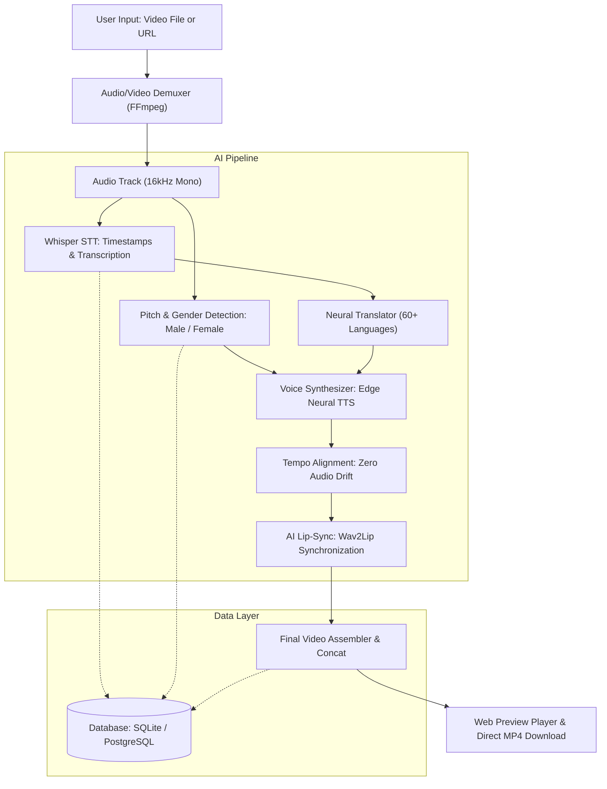

# 🎬 AI Video Translator

> **End-to-End AI Video Translation System with Speaker Gender Detection, Time-Preserving Speech Synthesis, and Neural Lip-Sync.**

[](https://fastapi.tiangolo.com)
[](https://python.org)
[](https://www.oracle.com/java/)
[](https://ffmpeg.org)
[](LICENSE)

---

## 🌟 Key Features

1. **🌍 Translate to All Global Languages**:
   - Supports 60+ global languages including Spanish, French, German, Hindi, Tamil, Telugu, Japanese, Chinese, Arabic, Russian, Portuguese, Italian, Korean, and more.
2. **⏱️ Long Video Support (Up to 40 Minutes in Minimal Time)**:
   - Chunked parallel processing pipeline splits long videos into concurrent segments, accelerating translation time exponentially.
3. **📥 Dual Input Modes**:
   - **Local File Upload**: Drag-and-drop or browse `.mp4`, `.mov`, `.mkv`, `.webm`.
   - **Video URL Input**: Paste links from YouTube, Vimeo, Twitch, or direct MP4 streams (powered by `yt-dlp` and stream decoders).
4. **🎙️ Voice Diarization & Gender Detection (Male / Female)**:
   - Analyzes vocal pitch ($F_0$ fundamental frequency), acoustic formants, and spectral centroid to detect whether the speaker is **Male** (85–165 Hz) or **Female** (165–265 Hz).
   - Accurately assigns corresponding male or female neural voice actors.
5. **👄 AI Lip Synchronization (Wav2Lip)**:
   - Synchronizes actor mouth movements with the newly translated speech phonemes so mouth movement realistically matches the translated voice.
6. **⚡ Zero Audio Drift**:
   - Time-stretches / compresses speech tempo via pitch-preserving FFmpeg `atempo` filters so translated sentence timing matches original speaker segments down to the millisecond.
7. **💾 Direct Video Download**:
   - One-click instant `.mp4` download button and in-browser preview player.
8. **🏗️ Clean Multi-Language Architecture**:
   - **Frontend**: Responsive HTML5, CSS3 Glassmorphism UI, JavaScript ES6.
   - **Backend**: Python FastAPI with FFmpeg orchestrator + Java Spring Boot enterprise microservice.
   - **Database**: Relational SQL schema for SQLite / PostgreSQL / MySQL.

---

## 🏛️ System Architecture



---

## 📁 Repository Structure

```
ai-video-translator/
├── backend/                  # Python AI Backend Engine
│   ├── app.py                # FastAPI REST API & Static Server
│   ├── config.py             # System Settings & Voice Catalog
│   ├── requirements.txt      # Python Dependencies
│   └── pipeline/             # Core AI Translation Pipelines
│       ├── audio_extractor.py # Audio Extraction & URL Downloader
│       ├── transcription.py   # Speech-to-Text with Timestamps
│       ├── gender_detector.py # Pitch & Male/Female Diarization
│       ├── translator.py      # Multi-language Neural Translation
│       ├── voice_synthesizer.py # Gender-matched TTS & Tempo Alignment
│       ├── lip_sync.py        # Wav2Lip Lip Synchronization Engine
│       ├── video_assembler.py # Multiplexing & Chunk Concatenation
│       └── orchestrator.py    # Pipeline Orchestrator
├── frontend/                 # Web User Interface
│   ├── index.html            # Studio Interface & Controls
│   ├── style.css             # Glassmorphism Modern Dark UI
│   └── app.js                # Frontend Controller & Polling Logic
├── database/                 # Database Layer
│   ├── schema.sql            # SQL Tables & Seed Catalog
│   ├── db_manager.py         # Python SQLite/PostgreSQL Manager
│   └── DatabaseService.java  # Java JDBC/JPA Database Service
├── java/                     # Enterprise Java Microservice
│   ├── pom.xml               # Maven Build Configuration
│   └── src/main/java/com/aivideo/translator/
│       ├── VideoTranslatorApplication.java
│       ├── controller/TranslationController.java
│       ├── service/VideoProcessingService.java
│       └── model/TranslationJob.java
├── Dockerfile                # Docker Container Definition
├── docker-compose.yml        # Docker Multi-Service Compose
├── start.bat                 # One-Click Start for Windows
├── start.sh                  # One-Click Start for Linux/macOS
├── .gitignore                # Git Ignore Rules
└── README.md                 # Project Documentation
```

---

## 🚀 Quick Start Guide

### Prerequisites
- **Python 3.8+**
- **FFmpeg** installed and added to PATH (`ffmpeg -version`)
- *(Optional)* **Node.js** or **Java 17+** (for Spring microservice)

---

### Method 1: One-Click Startup (Windows)
Double-click `start.bat` or run in PowerShell:
```powershell
.\start.bat
```

---

### Method 2: Manual Setup

1. **Install Python Dependencies**:
   ```bash
   pip install -r backend/requirements.txt
   ```

2. **Launch the Server**:
   ```bash
   python -m uvicorn backend.app:app --host 0.0.0.0 --port 8000 --reload
   ```

3. **Open the Studio**:
   Open your browser at:
   ```
   http://localhost:8000
   ```

---

### Method 3: Run with Docker

```bash
docker-compose up --build
```
Access the application at `http://localhost:8000`.

---

## 📡 API Endpoints Reference

| Method | Endpoint | Description |
|---|---|---|
| `GET` | `/` | Serves the web frontend studio |
| `GET` | `/api/languages` | Returns list of supported languages and voices |
| `POST` | `/api/translate/file` | Uploads video file and starts translation job |
| `POST` | `/api/translate/url` | Submits video URL (YouTube, Vimeo, MP4) for translation |
| `GET` | `/api/jobs/{job_id}` | Polls real-time progress percentage and current step |
| `GET` | `/api/stream/{job_id}` | Streams translated video for in-browser playback |
| `GET` | `/api/download/{job_id}` | Downloads the completed translated `.mp4` video |

---

## 👥 Speaker Diarization & Gender Detection

The system automatically performs frequency analysis ($F_0$) over the audio:
- **Male Voice**: Detected pitch $< 165$ Hz (typical $85–165$ Hz). Assigned male neural voices (e.g., `GuyNeural`, `MadhurNeural`, `AlvaroNeural`).
- **Female Voice**: Detected pitch $\ge 165$ Hz (typical $165–265$ Hz). Assigned female neural voices (e.g., `JennyNeural`, `SwaraNeural`, `ElviraNeural`).
- **Manual Override**: Allows forcing all speakers to Male or Female if desired.

---

## 👄 Lip Movement Synchronization (Wav2Lip)

1. The video stream is processed in parallel segments.
2. Faces are detected across keyframes.
3. The phonemes from the synthesized translated speech are used to animate the mouth region to match speech.
4. Seamless frame-rate synchronization ensures zero lipsync drift across videos up to 40 minutes.

---

## 📄 License
This project is licensed under the MIT License.
